# QuizApp

### A few minutes. A few good questions.

Play a quick round, build a quiz for your friends, or turn the questions you missed into your next practice session.

**[Try the live app](https://quizzivora.vercel.app/) · [View screenshots](#screenshots) · [Explore the features](#features-at-a-glance) · [Run locally](#run-locally)**

No sign-up required · Practice and exam modes · Custom quizzes · Friend challenges

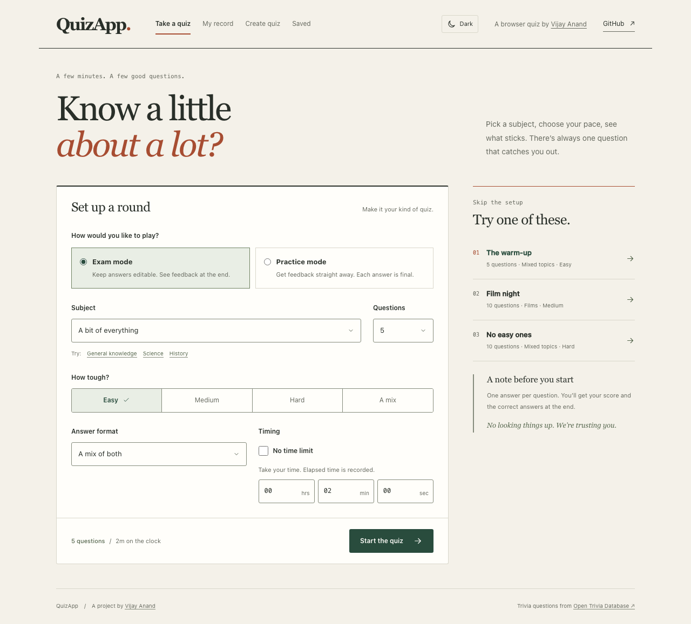

QuizApp is a React quiz application for a short trivia break, a focused study session, or a round you make yourself. Choose a subject and pace, keep useful questions, and see how your scores change over time. Your quiz setup, saved questions, and records have their own spaces, keeping the playing area focused.

> The screenshots below show the current source running locally with illustrative questions, drafts, and sample history. The live app reflects its latest deployment.

## Contents

- [Screenshots](#screenshots)
- [Features at a glance](#features-at-a-glance)
- [Your first round](#your-first-round)
- [Practice and exam modes](#practice-and-exam-modes)
- [Navigate questions at your own pace](#navigate-questions-at-your-own-pace)
- [Scores, answer review, and custom test names](#scores-answer-review-and-custom-test-names)
- [Save questions and practise them later](#save-questions-and-practise-them-later)
- [Build and share your own quiz](#build-and-share-your-own-quiz)
- [Custom quiz attempt limits](#custom-quiz-attempt-limits)
- [Organise quizzes into collections](#organise-quizzes-into-collections)
- [Challenge a friend](#challenge-a-friend)
- [Share a scorecard](#share-a-scorecard)
- [Recent rounds, personal bests, and progress](#recent-rounds-personal-bests-and-progress)
- [Themes, accessibility, and reliability](#themes-accessibility-and-reliability)
- [Data, limits, and privacy](#data-limits-and-privacy)
- [Run locally](#run-locally)
- [Development and deployment](#development-and-deployment)
- [Frequently asked questions](#frequently-asked-questions)
- [Contributing and credits](#contributing-and-credits)

## Screenshots

Click a screenshot to open the full-size image. More screenshots appear alongside the feature guides below.

| Practice with immediate feedback                                                                                                           | Build your own questions                                                                                                                            |
| ------------------------------------------------------------------------------------------------------------------------------------------ | --------------------------------------------------------------------------------------------------------------------------------------------------- |
| [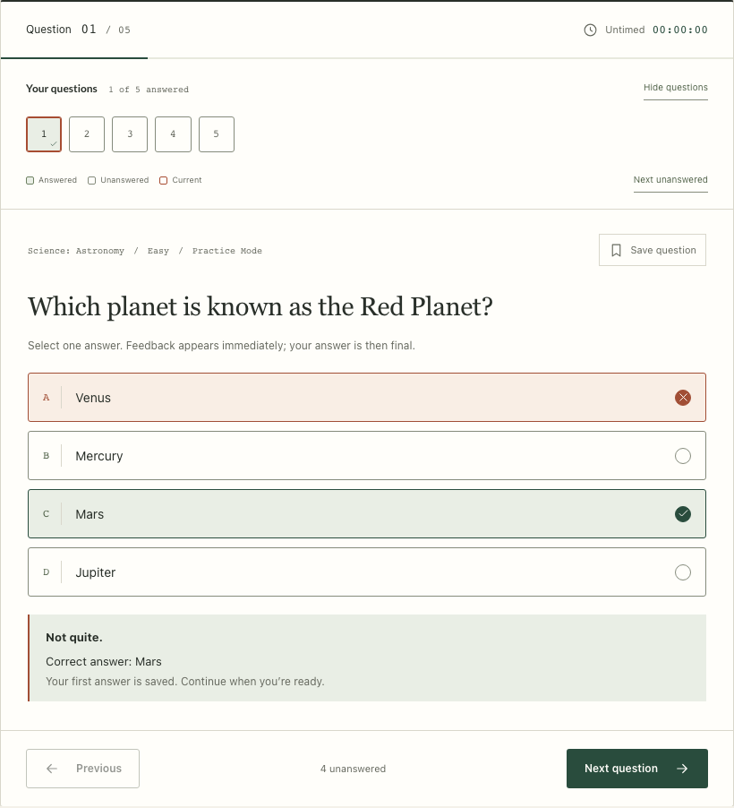](docs/images/practice-mode.png) | [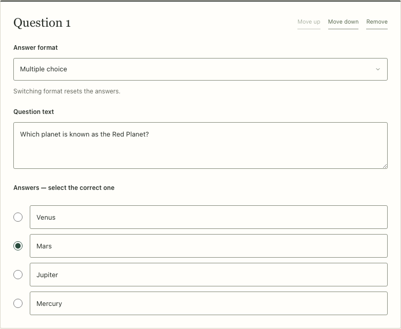](docs/images/quiz-builder.png) |
| **Organise quizzes into collections**                                                                                                      | **Track your progress**                                                                                                                             |
| [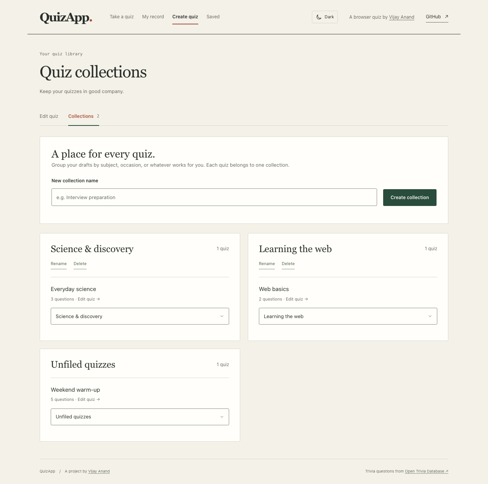](docs/images/quiz-collections.png)       | [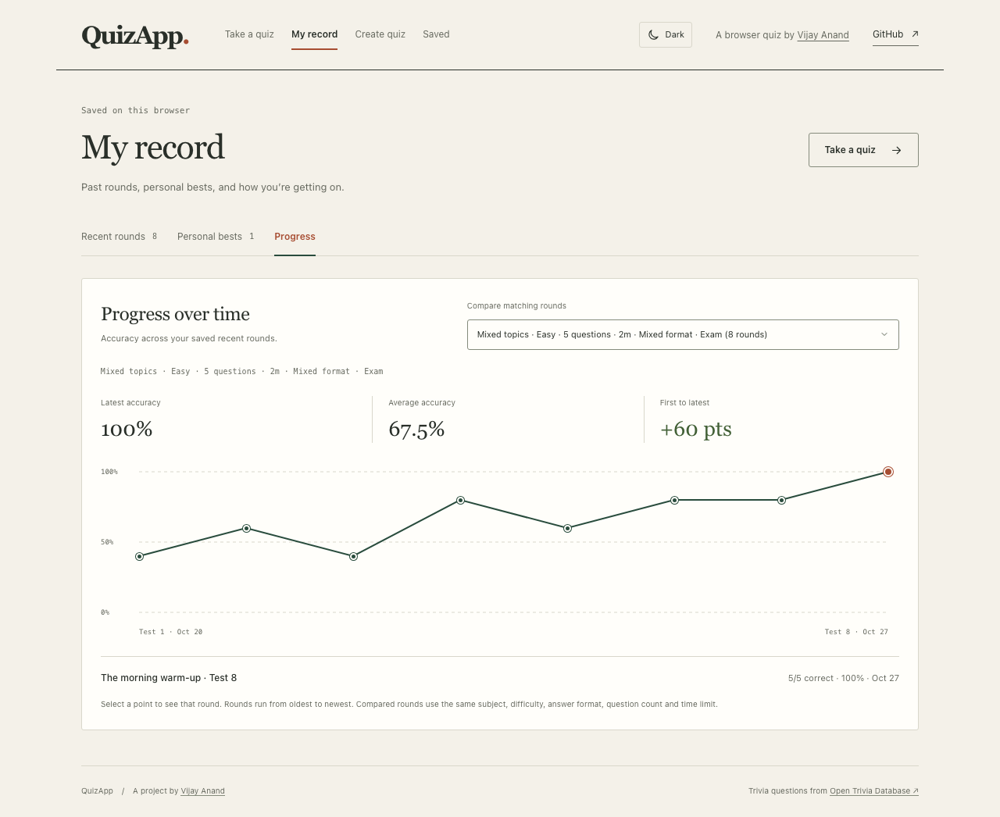](docs/images/progress-over-time.png)      |

**Want to browse all 16 screenshots?** Open [docs/gallery.html](docs/gallery.html) in a web browser for a dedicated image gallery, or browse the [screenshot folder](docs/images/). In VS Code, open this README and press **⌘⇧V** on macOS or **Ctrl+Shift+V** on Windows/Linux to render the embedded images. The source editor displays image links as text.

For images to appear on GitHub, include both `README.md` and the `docs/` folder in your commit and push.

## Features at a glance

| Make it your kind of quiz    | What you can do                                                                                     |
| ---------------------------- | --------------------------------------------------------------------------------------------------- |
| **Flexible trivia rounds**   | Choose a subject, 1–50 questions, difficulty, answer format, and a timer—or play untimed.           |
| **Quick-start presets**      | Load The warm-up, Film night, or No easy ones without configuring every setting.                    |
| **Two ways to play**         | Use immediate-feedback practice or an exam with feedback at the end.                                |
| **Question navigator**       | Jump between questions, find the next unanswered question, and see your progress.                   |
| **Useful answer review**     | Filter correct, incorrect, and unanswered questions; compare your answer with the correct one.      |
| **Bookmarks**                | Save up to 200 questions, search your library, and practise a selection later.                      |
| **Custom quiz builder**      | Write multiple-choice and true/false questions, set correct answers, and save drafts automatically. |
| **Shareable custom quizzes** | Send a playable snapshot with its mode, time limit, and optional attempt allowance.                 |
| **Quiz collections**         | Create, rename, and manage collections for your own quiz drafts.                                    |
| **Friend challenges**        | Send the exact round you played and compare your friend's score with yours.                         |
| **Shareable results**        | Download a PNG scorecard, copy a result, or use device sharing where supported.                     |
| **Personal records**         | Give rounds a name, revisit recent scores, and compare matching personal bests.                     |
| **Progress charts**          | Explore accuracy trends and select individual rounds on the chart.                                  |
| **Comfortable controls**     | Light/dark themes, responsive layouts, optional keyboard shortcuts, and accessible controls.        |
| **Browser-based storage**    | Keep records, bookmarks, drafts, collections, and preferences without creating an account.          |

## Your first round

1. Open **[QuizApp](https://quizzivora.vercel.app/)** and choose **Take a quiz**.
2. Choose **Exam mode** or **Practice mode**.
3. Pick a subject, question count, difficulty, and answer format.
4. Set a time limit, or select **No time limit**.
5. Select **Start the quiz**, answer the questions, and review your result.

You can mix subjects or choose from topics including general knowledge, books, films, music, science, computers, mathematics, geography, history, sports, and more. Difficulty can be **Easy**, **Medium**, **Hard**, or **A mix**. Answer formats include **Multiple choice**, **True / False**, and **A mix of both**.

The suggested rounds give you a starting point:

| Preset       | Questions | Subject      | Difficulty | Time      |
| ------------ | --------- | ------------ | ---------- | --------- |
| The warm-up  | 5         | Mixed topics | Easy       | 2 minutes |
| Film night   | 10        | Films        | Medium     | 5 minutes |
| No easy ones | 10        | Mixed topics | Hard       | 3 minutes |

Selecting a preset fills the settings; you can adjust them before starting. Built-in trivia questions are fetched from [Open Trivia Database](https://opentdb.com/), so new trivia rounds need an internet connection and depend on the questions available for your chosen settings.

## Practice and exam modes

| Behaviour          | Practice mode                                         | Exam mode                                     |
| ------------------ | ----------------------------------------------------- | --------------------------------------------- |
| Feedback           | Correct answer appears immediately after you choose.  | Feedback appears after the round ends.        |
| Change an answer   | Your first answer is final once feedback is revealed. | Answers remain editable before finishing.     |
| Previous questions | Revisit answers and their feedback.                   | Revisit and edit answers.                     |
| Timing             | Timed or untimed, according to your settings.         | Timed or untimed, according to your settings. |
| Final result       | Scorecard and full answer review.                     | Scorecard and full answer review.             |

Custom quiz creators choose the mode their players will use. Shared custom quizzes and friend challenges retain that choice. Practice and exam results are compared separately in personal bests and progress charts.


## Navigate questions at your own pace

The quiz screen includes:

- **Previous** and **Next question** controls.
- A numbered navigator with distinct **current**, **answered**, and **unanswered** states.
- **Next unanswered** to move directly to a skipped question.
- **Show questions / Hide questions** to keep the navigator compact.
- An answer-count progress bar and a remaining-question count.
- **Review unanswered** when you reach the final question with gaps still to fill.
- A countdown for timed rounds and elapsed time for untimed rounds.

On wider screens, changing questions preserves your scroll position. On small screens, the next question moves into view. The timer uses elapsed wall-clock time and catches up after background-tab throttling. When a timed round expires, you can check the answers you completed; unanswered questions stay visible in the result breakdown.

You can visit **My record**, **Saved**, or **Create quiz** and return to the active round during the same visit. Its timer continues. Refreshing or closing the page does **not** save an unfinished round for later resumption.

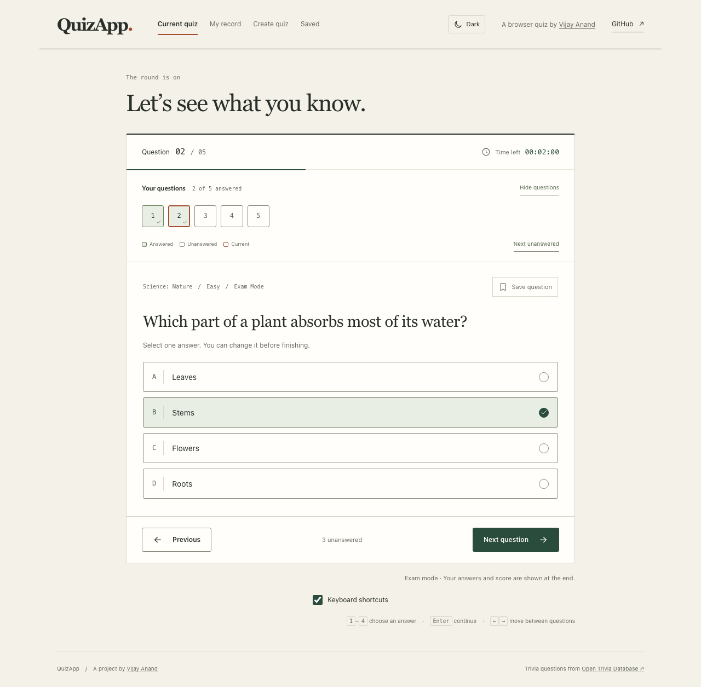

### Optional keyboard shortcuts

| Key                    | Action                                                             |
| ---------------------- | ------------------------------------------------------------------ |
| `1`–`4`                | Select the corresponding answer option.                            |
| `Enter`                | Continue, review unanswered questions, or finish when appropriate. |
| `←`                    | Go to the previous question.                                       |
| `→`                    | Continue to the next question when an answer is selected.          |
| `Tab`, `Shift` + `Tab` | Move through interactive controls.                                 |
| `Space`, `Enter`       | Activate a focused control using its normal keyboard behaviour.    |

Use the **Keyboard shortcuts** checkbox to turn quiz shortcuts on or off. The preference is saved in this browser. Shortcuts leave text fields, dialogs, and unrelated navigation controls alone, and they are inactive while another app area is open.

## Scores, answer review, and custom test names

Every completed round has a **Scorecard** and **Review answers** view.

The scorecard shows your score, accuracy, elapsed time, and counts of correct, incorrect, and unanswered questions. Select a breakdown count to jump into that answer-review filter. The displayed passing score is **60%**.

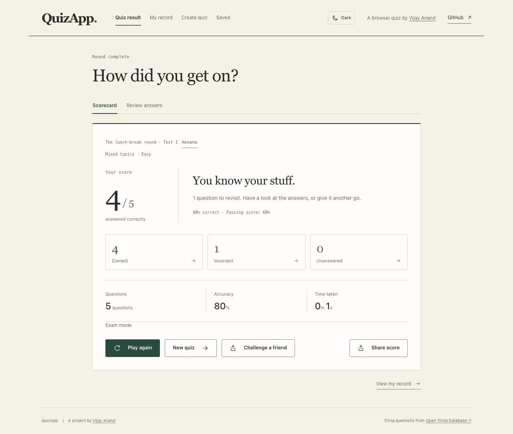

In **Review answers**, you can:

- Filter **All**, **Correct**, **Incorrect**, or **Unanswered** questions.
- Compare your submitted answer with the correct answer.
- Save an interesting or difficult question for later practice.

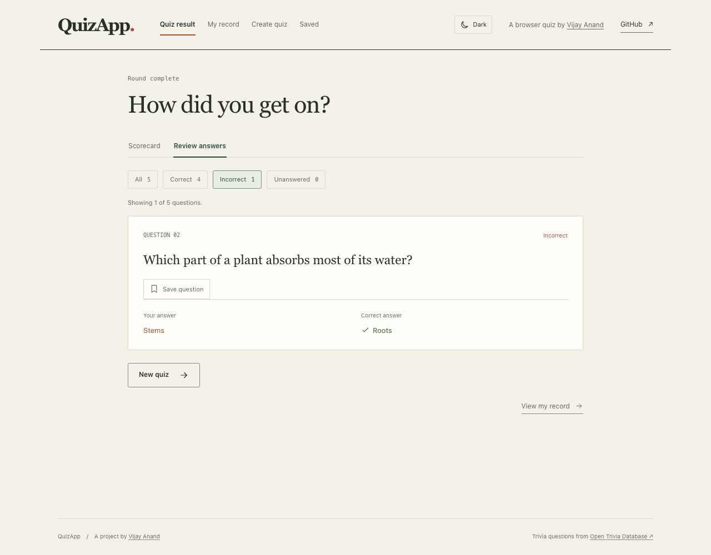

### Give each round a useful name

Rounds receive a test number automatically, such as **Mixed topics · Test 1** and **Mixed topics · Test 2**. Select **Rename** on a scorecard or record entry to add a name such as **The lunch-break round**.

Names support up to **60 characters**. The test number stays attached, and the original subject remains available alongside a custom name. Leaving the name blank restores the default. Renaming a round also updates its matching history, personal-best entry, and shared scorecard text.

**Play again** starts the same set of questions with shuffled questions and answer options for a regular replay. Friend-challenge replays preserve the original ordering. Custom quiz attempt limits still apply to replays. **New quiz** returns to setup.

## Save questions and practise them later

Select **Save question** during a round or in answer review. Open **Saved** in the main navigation to build a personal question library.

- Keep up to **200 saved questions**.
- Search by question text or subject.
- Reveal answers when studying your library.
- Remove a question and use **Undo** to restore it.
- Select up to **50 questions** for **untimed practice with immediate feedback**.
- Use **Select visible** after a search, or **Clear selection** to choose a different set.

The same question is recognised when its answer options are shuffled, keeping repeat saves out of your library. Questions belonging to your active exam keep their answers hidden in the library until that exam finishes.

Saved-question practice is a separate study round: it does not consume the allowance of the original shared custom quiz. Finish your current round before starting another. Removing a bookmark does not alter a practice round already in progress.

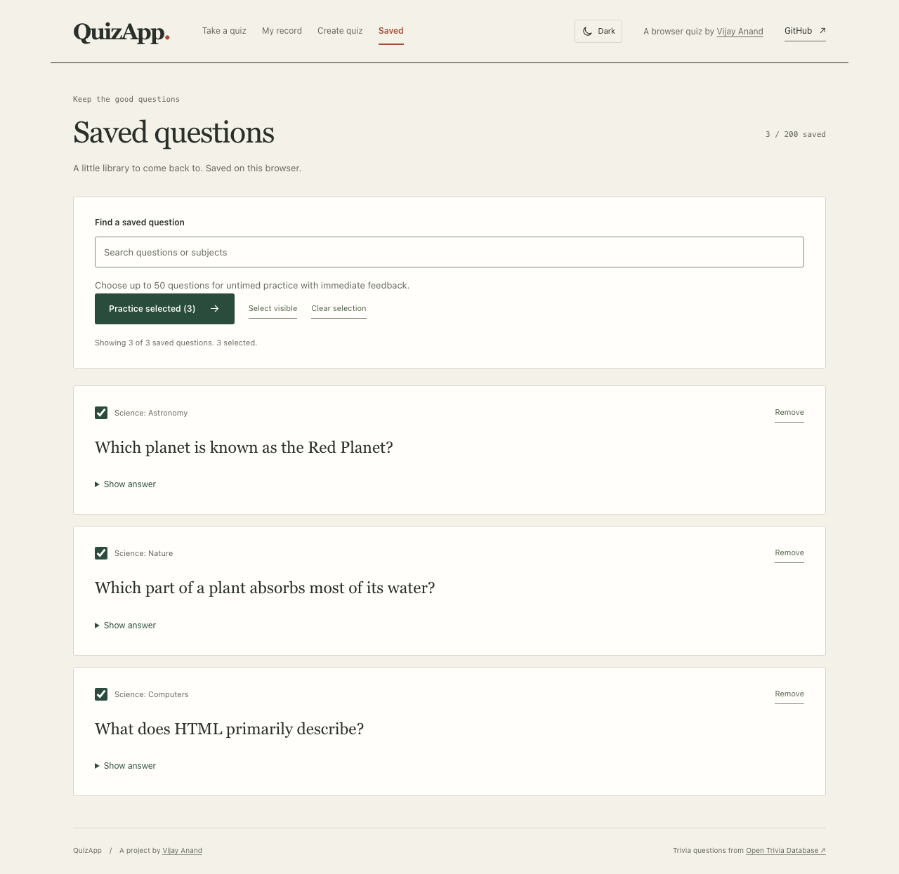

## Build and share your own quiz

Open **Create quiz → Edit quiz** to make a round for a study group, a classroom activity, interview preparation, or a weekend game.

### Create questions

- Add a quiz title, your optional name, and an optional introduction.
- Write **multiple-choice questions with four answers** or **true/false questions**.
- Mark the correct answer for every question.
- Add, reorder, and remove questions; use **Undo** after removing one.
- Keep up to **10 drafts**, each with up to **50 questions**.
- Switch between saved quizzes using **Your quizzes**.
- Delete a draft after confirming when you no longer need it.

Edits save automatically in this browser, including incomplete drafts. Before playing or sharing, validation checks the title, question text, answer choices, and correct-answer selections. Incomplete or duplicate answer choices are highlighted so you can fix them.

Question and answer text supports Unicode and literal code-like text. A title can contain up to **60 characters**, the author name **40**, the introduction **240**, each question **1,000**, and each answer option **200**.


### Choose how it plays

Set **Practice mode** or **Exam mode**, choose a collection, add an optional time limit, and set **Allowed attempts**. Custom quiz timers can be set from **1–180 minutes**, or disabled with **No time limit**.

<details>
<summary>See the custom quiz settings</summary>

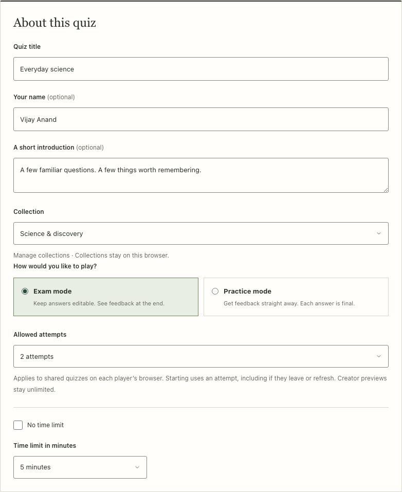

</details>

### Preview and share

1. Select **Play quiz** to preview your questions. Creator previews are unlimited and do not consume shared-quiz attempts.
2. Select **Create quiz link** when the quiz is ready.
3. Use **Copy quiz link**, or **Send quiz** when device sharing is available.
4. Your player opens the invitation and selects **Start this quiz**.

A shared link contains a snapshot of the quiz, including its questions, correct answers, mode, time limit, and attempt allowance. Players can open it without fetching another set of trivia questions or creating an account. Later edits require a new link; previously shared links retain the version originally sent.

## Custom quiz attempt limits

Choose **Unlimited attempts** or an allowance of **1–10 attempts**. Invitations show the remaining allowance, and active rounds and results show the current attempt number.

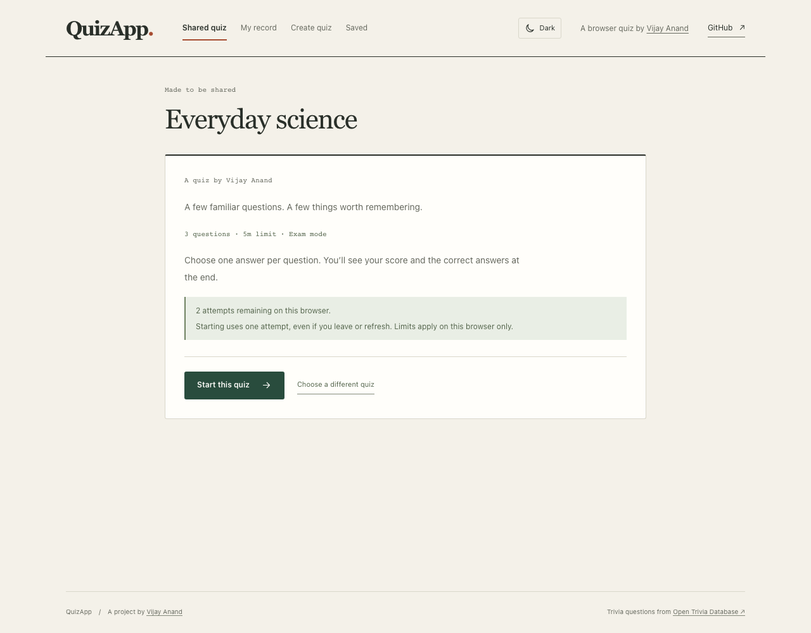

| Action                                            | Effect on the allowance                                   |
| ------------------------------------------------- | --------------------------------------------------------- |
| Start a shared custom quiz                        | Uses one attempt before play begins.                      |
| Replay it                                         | Uses another attempt.                                     |
| Leave, refresh, or run out of time                | The started attempt remains used.                         |
| Use all allowed attempts                          | Starting again and replaying are blocked in that browser. |
| Preview from the builder                          | No shared-quiz attempt is used.                           |
| Clear My record                                   | Attempt counts stay intact.                               |
| Edit quiz questions and share their new revision  | The new revision gets its own allowance.                  |
| Change only the title, mode, timing, or allowance | The existing revision keeps its used-attempt count.       |

Custom friend challenges carry the same allowance and quiz revision. Counts update across tabs, with browser locking used where available to coordinate simultaneous starts. Limited quizzes require working browser storage.

**The allowance applies per browser, not per person.** Another browser/device or clearing site data gives a separate count. This is a casual-play feature; accounts and server-side records would be needed for enforced limits across devices.

## Organise quizzes into collections

Open **Create quiz → Collections** to keep your quiz drafts organised.

- Create up to **20 collections**, with names up to **40 characters**.
- Assign a collection in the quiz editor or move a quiz using its collection dropdown.
- Browse quizzes by collection and open a quiz directly for editing.
- Rename a collection as your library grows.
- Delete a collection without deleting its quizzes: they move to **Unfiled quizzes**.

Each quiz belongs to one collection. Collections organise your local drafts; they do not change the questions in existing shared links and are not sent as part of those links.


## Challenge a friend

Finished a round worth sharing? Turn it into a friendly competition.

1. Select **Challenge a friend** on your scorecard.
2. Enter your name if you want, then select **Create challenge link**.
3. Copy or share the link.
4. Your friend selects **Accept challenge** and plays the **same questions, answer order, mode, and time limit**.
5. Their result compares both scores and times. **Most correct answers wins; equal scores are a draw.**

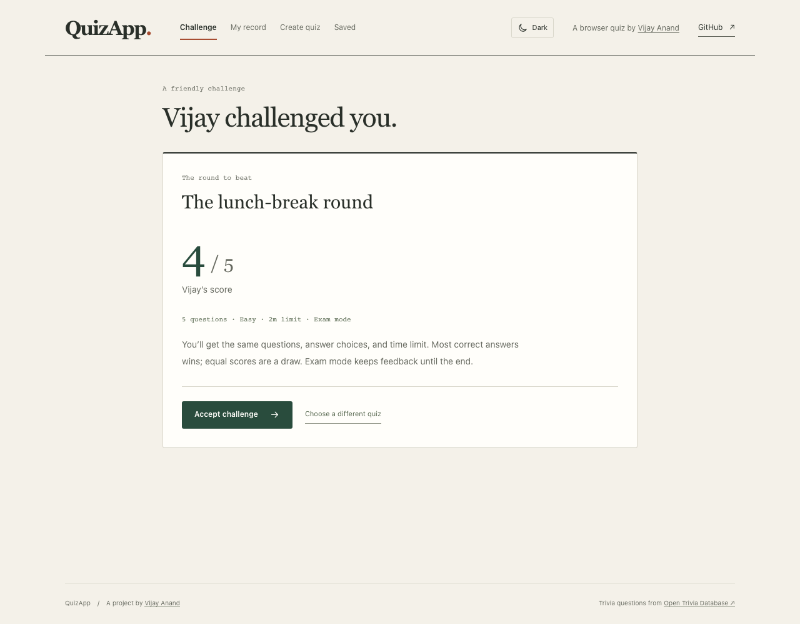

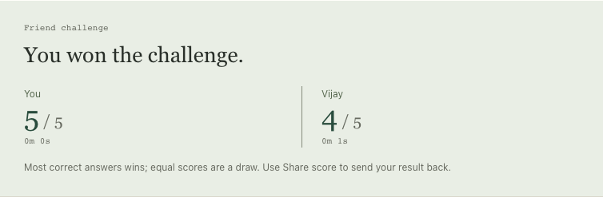

Challenges work with built-in trivia rounds and custom quizzes. The link includes the host's result, so the comparison does not need accounts or a live shared session. Your friend can use **Share score** to send their result back. There is no automatic result notification or shared live leaderboard.

## Share a scorecard

Select **Share score** after a round to:

- Preview a generated **PNG scorecard**.
- **Download image** to save or post it.
- **Copy result** to share text and a link to the app.
- Use your device's native share menu where supported, including an image attachment when available.

The scorecard includes the round name, score, accuracy, timing, and app address. Practice results are labelled as practice. A score-sharing link leads to the app; use **Challenge a friend** to send the actual questions.

If device sharing or clipboard access is unavailable, you can still select and manually copy the displayed result text or generated quiz links.

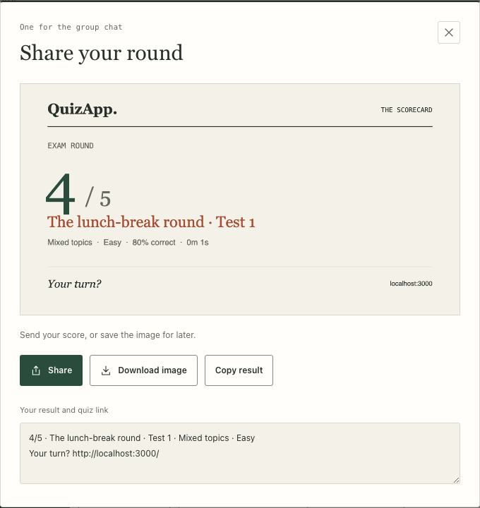

## Recent rounds, personal bests, and progress

Open **My record** for a separate area dedicated to your learning history.

### Recent rounds

See your **last 20 completed rounds**, including their names/test numbers, scores, settings, dates, mode, and relevant custom-attempt or challenge details. Expand the list to see older recent entries, rename a round, or clear the history after confirming.

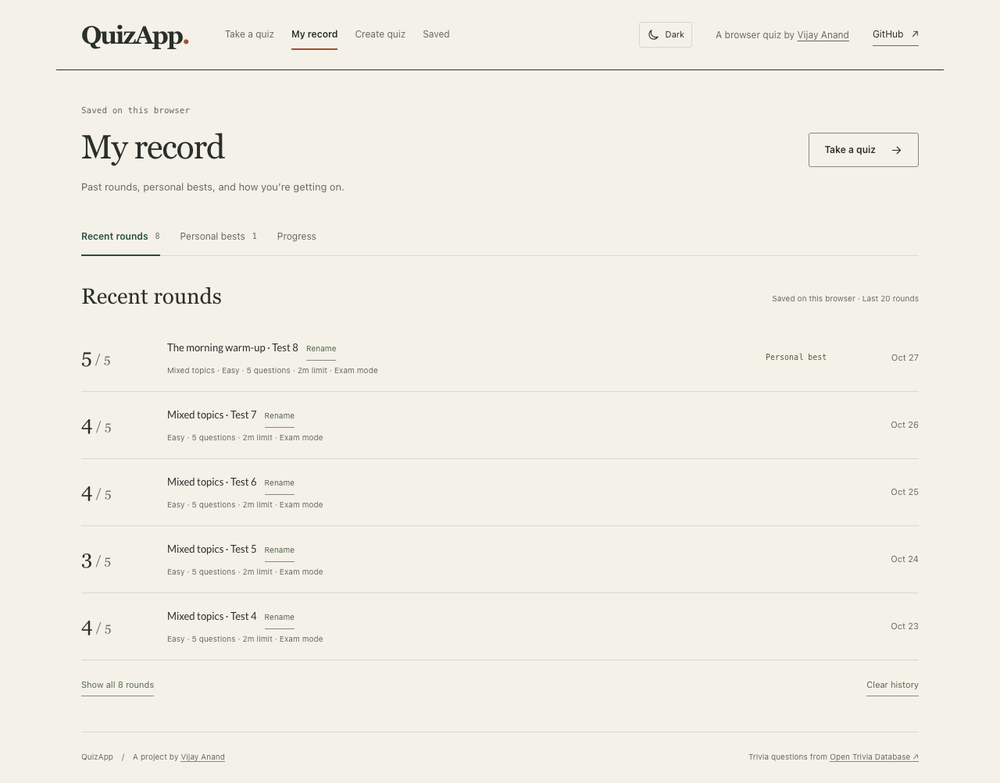

### Personal bests

Compare results with matching subject, difficulty, answer format, question count, and time limit. A higher score wins; equal scores are compared by time taken. Personal bests are retained independently of the 20-round recent-history window.

Custom quizzes are matched by their quiz identity and question revision. Practice and exam results have separate comparison groups, and saved-question practice is tracked separately. Improved previous bests produce a **New personal best** notice on the result screen.

### Progress over time

Choose a matching group to see:

- **Latest accuracy**.
- **Average accuracy** across that group's saved recent rounds.
- **First-to-latest change** in percentage points.
- An interactive accuracy chart, ordered from oldest to newest.

Select, focus, or hover over a point to inspect that round's name, score, accuracy, and date. Larger charts scroll horizontally on small screens. One completed round starts a chart; a second matching round starts a trend.


## Themes, accessibility, and reliability

### Light and dark themes

The initial theme follows your saved choice or your system preference. Use the theme button to switch; your selection is saved in the browser. Layouts adapt to desktop, tablet, and mobile screens.

<p align="center">
  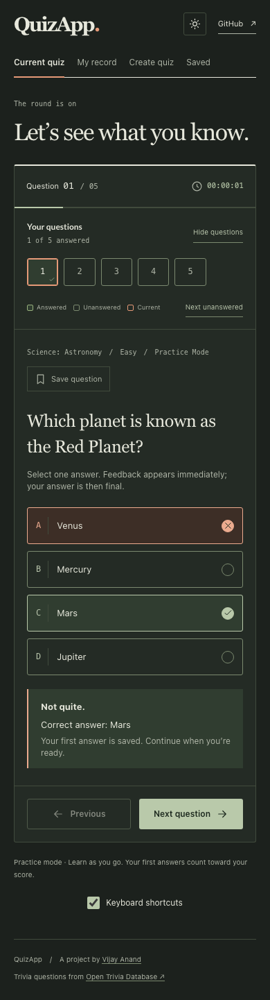
</p>

### Accessible interaction

The application includes:

- A **Skip to main content** link and visible keyboard focus styles.
- Labelled form controls, native buttons, and keyboard-operable tabs.
- Announced loading states, errors, progress, and practice feedback.
- Focus management when moving between questions and app areas.
- Text labels and state indicators alongside colour cues.
- Optional answer shortcuts and support for reduced-motion preferences.

### Recoverable failures

Connection issues, timeouts, incomplete question-service responses, and rate limits show recoverable messages while preserving quiz setup. Rate-limited requests offer a short retry countdown. Invalid shared links show a recovery page instead of starting a broken round.

When browser storage is unavailable, drafts, bookmarks, and records can remain usable for the current visit, with a storage notice. Limited-attempt shared quizzes require successful attempt storage before starting.

### Installation and offline use

The production app includes a web manifest and service worker. On supported browsers, **Install app** appears when an installation prompt is available. Installability and sharing controls depend on browser support.

After a production visit has cached the app, its shell can load offline. Locally stored custom quizzes, bookmarks, and self-contained shared rounds do not require the trivia API once the app can load. Fetching new built-in trivia rounds still requires a connection. The development server does not register the production service worker.

## Data, limits, and privacy

QuizApp currently runs without application accounts or a project-owned backend. Saved data lives in browser local storage; it is not automatically synced or backed up across browsers, devices, domains, or private browsing sessions. Clearing site data removes it.

| Item                      | Current limit or behaviour                                                |
| ------------------------- | ------------------------------------------------------------------------- |
| Built-in trivia round     | 1–50 questions                                                            |
| Custom quiz drafts        | 10 per browser                                                            |
| Questions per custom quiz | 50                                                                        |
| Custom quiz timer         | Untimed, or 1–180 minutes                                                 |
| Custom quiz allowance     | Unlimited, or 1–10 attempts per browser and question revision             |
| Quiz collections          | 20 per browser; 40 characters per name                                    |
| Bookmarks                 | 200 per browser                                                           |
| Bookmark practice         | Up to 50 selected questions per round                                     |
| Recent history            | Last 20 completed rounds                                                  |
| Custom test names         | Up to 60 characters; test numbers stay attached                           |
| Shared quiz/challenge URL | Up to 16,000 characters; large rounds may need fewer or shorter questions |

A few details help avoid surprises:

- **Browser storage is independent of links.** A shared quiz carries its questions and settings; your draft library and collections stay local.
- **Links contain answer data.** Treat custom quizzes and friend challenges as casual learning activities, not secure exams or verified competitions. Anyone with a link can inspect or forward its contents.
- **Challenges include a score snapshot.** They are not server-verified results or live multiplayer rooms.
- **History clearing is separate.** Clearing My record removes its rounds, bests, and numbering; it does not remove bookmarks, drafts, collections, or used attempts.
- **Sharing needs the right origin.** A link created on `localhost` points to your own computer. Use the deployed app to create links for other people.
- **Modern browsers compress shared links.** Plain links are supported when compression is unavailable during creation. Opening a compressed link requires browser support for decompression.
- **Unfinished rounds are not restored after refresh.** An attempt already started stays used.
- **External trivia requests go to Open Trivia Database.** The service receives the selected quiz-query parameters. The app's local records are separate from those requests.

## Run locally

You will need **Git, Node.js, and npm**. The project uses **Create React App 5**; use a Node/npm environment compatible with that toolchain.

```bash
git clone https://github.com/vijayanand1505/quiz-app.git
cd quiz-app
npm ci
npm start
```

Open **http://localhost:3000**. The development server reloads as you edit files. No API key or environment variables are required for the existing quiz features.

If port 3000 is occupied, accept the development server's suggested port and use that address. Keep the server running while using the local app. Local browser data is separate from data on the deployed website.

## Development and deployment

### Technology

| Area                    | Implementation                                                           |
| ----------------------- | ------------------------------------------------------------------------ |
| Interface               | React 18, responsive CSS, Semantic UI styles                             |
| Trivia source           | Open Trivia Database API                                                 |
| State                   | React hooks and browser local storage                                    |
| Sharing                 | URL-fragment payloads, browser compression, clipboard and Web Share APIs |
| Scorecard images        | HTML canvas exported as PNG                                              |
| Dialogs and time expiry | Native dialogs and SweetAlert2                                           |
| Offline shell           | Workbox service worker and web manifest in production                    |
| Tests                   | Jest and React Testing Library                                           |
| Component previews      | Storybook                                                                |
| Hosting configuration   | Vercel with a static Create React App build                              |

### Useful commands

| Command                                            | Purpose                                                                |
| -------------------------------------------------- | ---------------------------------------------------------------------- |
| `npm start`                                        | Start the development server.                                          |
| `npm test`                                         | Run tests in interactive watch mode.                                   |
| `CI=true npm test -- --watchAll=false --runInBand` | Run the test suite once, suitable for a POSIX shell or CI environment. |
| `npm run build`                                    | Generate the production app in `build/`.                               |
| `npm run storybook`                                | Open component previews on port 9009.                                  |
| `npm run build-storybook`                          | Generate the static Storybook preview.                                 |

The package also includes CRA's irreversible `eject` command and a legacy `gh-pages` deployment script. The Vercel workflow below uses `npm run build`.

### Project map

```text
src/
  components/
    App/                 App state, navigation, round lifecycle
    Main/                Trivia setup and presets
    Quiz/                Playing, mode feedback, and shortcuts
    QuestionNavigator/   Question states and direct navigation
    Result/              Scorecard and answer review
    QuizBuilder/         Custom quiz authoring and sharing
    QuizCollections/     Collection management
    SavedQuestions/      Bookmark library and practice selection
    ChallengeFriend/     Challenge-link creation
    ChallengeInvite/     Incoming friend challenges
    ChallengeComparison/ Challenge result comparison
    CustomQuizInvite/    Incoming custom quiz invitation
    Record/              History, personal bests, and progress navigation
    ProgressChart/       Interactive accuracy trends
    ShareButton/         Scorecard download and sharing
  hooks/                 Bookmark and attempt-storage subscriptions
  utils/                 Persistence, scoring, link codecs, and validation
  constants/             Subjects, question counts, and timing options
public/                  App shell, icons, and web manifest
vercel.json              Build and hosting configuration
docs/                    Screenshots and their capture instructions
```

Tests cover the quiz lifecycle, navigation, practice answer locking, storage failure handling, bookmarks, custom quiz validation, collections, shared links, attempt limits, and result comparisons. Documentation screenshots can be regenerated using the optional [capture guide](docs/README.md).

### Deploy to Vercel

The repository includes [vercel.json](vercel.json):

| Setting                            | Value                             |
| ---------------------------------- | --------------------------------- |
| Framework                          | Create React App                  |
| Install command                    | `npm ci`                          |
| Build command                      | `npm run build`                   |
| Output directory                   | `build`                           |
| Required app environment variables | None for the implemented features |

Import **vijayanand1505/quiz-app** into Vercel and select the branch you want to publish. For automatic deployments, connect that branch through Vercel's GitHub integration. A linked checkout can also be deployed with `npx vercel --prod`.

The public app is **https://quizzivora.vercel.app/**. Deploy the current source before expecting every feature pictured here to be available on the hosted version. HTTPS also enables the browser capabilities used by sharing and production installation.

## Frequently asked questions

<details>
<summary><strong>Do I need an account?</strong></summary>

No. You can play, create custom quizzes, bookmark questions, and keep local records without signing in. Those records stay in the browser where you created them.

</details>

<details>
<summary><strong>Why can I no longer change an answer?</strong></summary>

In Practice mode, the first choice is locked after feedback is shown. Choose Exam mode at setup when you want to revise answers before submitting.

</details>

<details>
<summary><strong>Why is “Start this quiz” or “Play again” disabled?</strong></summary>

A custom quiz may have used all allowed attempts in this browser, or attempt storage may be unavailable. Finish any active round before starting another. Invitations and results explain the relevant attempt state.

</details>

<details>
<summary><strong>Will editing my quiz update the link I already sent?</strong></summary>

No. Shared links are snapshots. Create and send a new link after editing. Question revisions have their own attempt allowance; changing metadata alone keeps the same used-attempt count.

</details>

<details>
<summary><strong>Can my friend see their result on my screen automatically?</strong></summary>

No. Their screen compares their result with the score in your challenge link. They can send their score back using Share score.

</details>

<details>
<summary><strong>Can I export, sync, or restore all my saved data?</strong></summary>

There is currently no full-library export, cloud sync, account backup, or unfinished-round restoration. Keep shared links for quizzes you want to send, and download individual scorecards from Share score.

</details>

<details>
<summary><strong>Why does a shared link fail to open?</strong></summary>

Copy the entire link, including everything after `#`. A link can be truncated by a messaging service, exceed the app's size limit, require decompression support, or point to somebody else's localhost. Try an up-to-date browser and ask the creator for a new link from the deployed app.

</details>

## Contributing and credits

Found a bug or have a focused improvement? [Open an issue](https://github.com/vijayanand1505/quiz-app/issues) with the steps to reproduce it, your browser/device, and the behaviour you expected. For code changes, keep generated caches and `node_modules` out of commits, run the relevant tests, and include screenshots for visual changes.

Built and maintained by **[Vijay Anand](https://github.com/vijayanand1505)**.

- Trivia service: [Open Trivia Database](https://opentdb.com/).
- UI foundation: [React](https://react.dev/) and [Semantic UI](https://semantic-ui.com/).
- Production tooling: [Create React App](https://create-react-app.dev/) and [Workbox](https://developer.chrome.com/docs/workbox/).

If you enjoy QuizApp, try a round with a friend, share a scorecard, or [star the repository](https://github.com/vijayanand1505/quiz-app).
